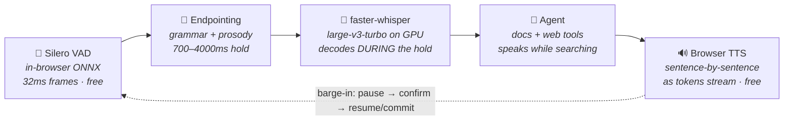
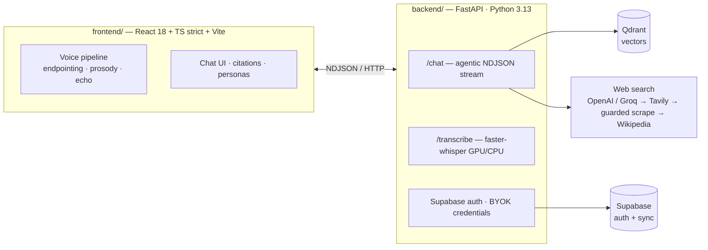

<div align="center">


# Nexus

### The self-hosted assistant that knows when you're done talking.

**Talk to your documents and the live web — hands-free, cited, self-hosted.**

[](https://github.com/sakshamkanojia19/nexus-voice-rag/actions/workflows/ci.yml)
[](LICENSE)
[](requirements.txt)
[](frontend/package.json)
[](frontend/tsconfig.json)
[](backend/main.py)
[](#-contributing)

**Designed, built and debugged by [Saksham Kanojia](https://github.com/sakshamkanojia19)**<br>
<sub>Every number on this page was measured on my own laptop and a 4GB GPU.</sub>

[Why Nexus](#-why-nexus) · [Features](#-features) · [How it works](#-how-a-voice-turn-works) · [Engineering log](#-engineering-log) · [What sets it apart](#-what-sets-nexus-apart) · [Quick start](#-quick-start)

</div>

---

## 💡 Why Nexus

Most "voice AI" demos cut you off after a fixed silence timer, talk over you, and route through a metered voice cloud that bills by the minute.

Nexus is built the other way around:

|  | Typical voice bot | **Nexus** |
|---|---|---|
| 🎤 Turn-taking | Fixed silence timer cuts you off mid-thought | Reads the **words**: "what's the capital of…" holds the mic, "…of France?" releases the mic in ~0.7s |
| ✋ Interruption | Talks over you, or hears itself and loops | **Barge-in with 6 stacked defences** — pause, confirm, resume or commit |
| 📝 Speech-to-text | Hosted API, billed per minute | **faster-whisper on your GPU**, ~2–3× realtime, decoding *while* you pause |
| 💸 Who pays | The operator, for everyone | **Nobody for voice when self-hosted** (local Whisper STT, browser TTS) · users bring their own **OpenAI, Grok or Groq** key for the LLM |
| 📚 Answers | Model memory only | Your documents + live web, **cited inline [n]** |
| 🔓 Source | Closed SaaS | **MIT open source, self-hosted, open-model speech recognition** |

> **The pitch in one line:** a research assistant that listens like a person, costs nothing per voice turn when self-hosted on your own GPU, and never spends the operator's money on a stranger's question.

---

## ✨ Features

<table>
<tr>
<td width="50%" valign="top">

### 🗣️ Voice that actually converses
- **Content-aware endpointing** — turn-end judged from grammar (dangling conjunctions, fillers, Hindi SOV terminals) + **pitch contour** tie-breaking, not a dumb timer
- **Barge-in done properly** — pause-then-confirm, false-interruption recovery that resumes on the exact word, history truncated to what you actually *heard*
- **Never talks to itself** — guarded VAD thresholds, fuzzy echo matching, sentence-level echo surgery on mixed recordings
- **15 languages, 7 of them Indian** (17 with regional English) — Hindi, Bengali, Tamil, Telugu, Marathi, Gujarati and Punjabi alongside English, Urdu, Arabic, Chinese, Japanese and major European languages; recognition, transcription and replies all follow the chosen language
- **22+ voice personas** — every system voice becomes a named agent with a locale-correct name: *Priya* for Hindi, *Kai* for UK English, *Greta* for German
- **TTS is browser-native `speechSynthesis` by choice** — zero-cost, offline, streams sentence-by-sentence; the swap seam for a studio-quality streaming vendor is [`useSpeech.ts`](frontend/src/hooks/useSpeech.ts)
- **Speaks while it works** — "One sec, looking that up" the instant a search starts

</td>
<td width="50%" valign="top">

### 📚 Grounded, agentic answers
- **Upload PDFs / DOCX / TXT / MD** → chunked, embedded, stored in Qdrant per account
- **The model routes itself** — knowledge answered instantly, your files via `search_documents`, the web via `search_web`; no regex triggers
- **Four search modes** — Instant · Web · Deep Research · Thinking; budget exhaustion **synthesizes** from gathered sources instead of apologizing
- **Trust-ordered web search** — your key's own hosted search → Tavily → guarded scraping that can't fabricate citations → Wikipedia, under a 14s ceiling
- **Streaming that doesn't jump** — one render per frame, finished paragraphs left alone, half-written markdown held back until it's whole
- **Inline `[n]` citations** mapping to document pages and URLs

</td>
</tr>
<tr>
<td valign="top">

### ⚡ Measured, not promised
| Stage | Latency |
|---|---|
| Whisper decode, 3.5s question | **~1.6s** (`large-v3-turbo`, GTX 1650 Ti) |
| Turn-end wait (complete sentence) | **700ms** · 1.2s when the voice rises at the end |
| Time-to-first-token (voice) | **0.5–2.6s** (Groq `gpt-oss-20b`, no search) |
| Web search, free path | **1.5–5.2s** per query, 14s ceiling |
| Cost per voice turn | **$0** self-hosted on your GPU · hosted deploys bill transcription to the user's own OpenAI or Groq key |

</td>
<td valign="top">

### 🔐 Built to host publicly
- **Supabase auth** (Google sign-in), verified server-side via JWKS
- **BYOK** — users bring their own OpenAI, xAI (Grok) or Groq key, routed by its prefix: per-request, never stored, never logged, redacted from errors, and never sent to any provider but its own
- `REQUIRE_USER_API_KEY=true` → **your key is never spent on strangers** — chat, transcription *and* document embedding all bill the caller
- Conversations sync across devices, local-first
- Everything degrades gracefully — vector DB down? Chat and voice keep working

</td>
</tr>
</table>

---

## 🔄 How a voice turn works



The trick that makes it feel instant: **nothing waits in line**. Whisper decodes while the endpointer waits out your pause; TTS speaks sentence one while sentence two is still streaming; a spoken acknowledgment covers the web-search gap.



Deep dives: [ARCHITECTURE.md](ARCHITECTURE.md) · [WORKFLOW.md](WORKFLOW.md) · [PROJECT_STRUCTURE.md](PROJECT_STRUCTURE.md)

---

## 🔬 Engineering log

The features above are the result. This is the work behind them: real failures from captured sessions, what I measured, and what I changed. Each entry links to the code, where the full reasoning lives in comments.

**1. A silence timer can't tell a pause from an ending.**
"What's the capital of…" and "What's the capital of France?" end in the same silence. I built an endpointer that reads the words instead (dangling conjunctions, fillers, Hindi's verb-final grammar) and uses pitch contour as the tie-breaker, holding the mic 700–4000ms depending on how finished the sentence sounds. Whisper decodes speculatively during that hold, so most of the wait doubles as decode time. → [`endpointing.ts`](frontend/src/lib/endpointing.ts) · [`prosody.ts`](frontend/src/lib/prosody.ts)

**2. The assistant kept hearing itself.**
Speaker audio leaks into the mic, and the recognizer hands the reply back as a new question. I stacked six defences against it, down to sentence-level echo surgery that cuts the assistant's words out of a mixed recording and keeps the user's. The hardest case came from a captured session: a real interruption arrived *silent* during playback, was classified as echo, and was thrown away three times in a row. It is now transcribed instead of assumed. → [`echo.ts`](frontend/src/lib/echo.ts) · [`voice-gate.ts`](frontend/src/lib/voice-gate.ts)

**3. CPU Whisper is a trap.**
Bigger Whisper models are more accurate, so the instinct is to take the biggest. I measured what that costs on CPU (8 cores, int8, a 4.7s clip):

| Model | Time to transcribe 4.7s of speech |
|---|---|
| `base` | 3.1s — the only one faster than the speech itself |
| `small` | 9.1s |
| `large-v3-turbo` | 18.2s |
| `distil-large-v3` | 21.3s |

On my GTX 1650 Ti, `large-v3-turbo` runs ~2–3× faster than realtime (1.6s for a 3.5s question), but only with `int8_float16`. Plain `float16` is ~4× slower on a card without tensor cores. So `auto` picks the model from the device, and if CUDA breaks, voice steps down a model ladder to CPU instead of dying. → [`stt.py`](backend/stt.py)

**4. Whisper hears "RAG" as "drag".**
It guesses toward common English. I feed it an initial prompt built from the conversation's own vocabulary, which biases the decoder toward the words this user is actually using without forcing them. → [`whisper-prompt.ts`](frontend/src/lib/whisper-prompt.ts)

**5. Whisper invents text on silence.**
"Thanks for watching!", a YouTube-subtitle artifact, arrived looking exactly like a real transcript and got answered as a question. Segments are now filtered on no-speech probability and log-probability, against a list of known artifacts (including a Hindi one), and for the prompt being echoed back. Hosted Whisper gets the same filter: it is asked for per-segment confidences instead of plain text, after speaker echo came back as "I'm sorry." and "And I will tell you." and was answered as the user's words. → [`stt.py`](backend/stt.py)

**6. Scraped web search is confidently wrong.**
When a search engine blocks a scraper, it still answers HTTP 200. "Elon Musk total revenue 2026" came back as snail-mucin skincare listings, which would have become citations. Every scraped result now has to pass a relevance gate tuned on real data: every off-topic result scored 0.0, thin-but-genuine matches scored 0.25, and the cutoff sits at 0.2. Scraping is also the last resort, behind real search APIs. → [`web_search.py`](backend/web_search.py)

**7. An API key can leak through an error message.**
Providers quote the rejected key in their 401 response. Every error is redacted before it is logged or shown, and user keys never enter shared client caches. Since adding Grok and Groq, a key only ever travels to its own provider: a feature that provider lacks is switched off, never quietly paid for with the operator's key. 37 tests hold these properties in place. → [`credentials.py`](backend/credentials.py) · [`providers.py`](backend/providers.py)

**8. Running out of tool calls produced an apology.**
The agent had gathered a dozen sources, then printed "please rephrase". Its final round now runs with tools disabled and has to write the answer from what it found. → [`agent.py`](backend/agent.py)

**9. Warming Whisper with silence warms nothing.**
Loading the model at boot still left the first spoken turn at 15.9s on a GTX 1650 Ti, against 1.6s for every turn after. A warm-up decode of four seconds of noise only got it to 4.7s: the decoder sets up its GPU kernels when it has words to produce. Nexus now decodes a bundled spoken sentence at boot, and the first real turn takes 1.6s. → [`stt.py`](backend/stt.py)

**10. Two of three web-search attempts could never succeed.**
The scraper's fallback attempts named search engines its library had since removed, and nothing bounded the whole ladder, so one search took 17–25s. It is now one bounded attempt, Wikipedia summaries fetched in parallel, a 14s ceiling, and a round's searches run concurrently: 1.5–5.2s on live queries. → [`web_search.py`](backend/web_search.py)

**11. Streaming answers jumped.**
Groq delivers tokens in bursts of hundreds. Every one re-rendered the app, re-parsed the whole answer's markdown and restarted a smooth scroll, while half-written syntax (`**bo`, `[1`, a table row) flashed raw and then snapped into place. Updates now land once per frame and are revealed at a steady pace, finished blocks are memoized, and incomplete markdown is held back until it's whole. Block elements rebuilt over one long answer: 29 → 6–7. → [`stream-markdown.ts`](frontend/src/lib/stream-markdown.ts) · [`MessageItem.tsx`](frontend/src/components/rag/MessageItem.tsx)

---

## 🆚 What sets Nexus apart

Voice-agent frameworks like [LiveKit Agents](https://github.com/livekit/agents) and [Pipecat](https://github.com/pipecat-ai/pipecat), are built around WebRTC media servers, and hosted platforms like Vapi and Retell bill by the minute. Nexus takes a different path:

- **It runs on a laptop.** No media server and no voice vendor; a 4GB GPU is the whole infrastructure, and a voice turn costs nothing.
- **Every voice decision is readable.** Endpointing, echo handling and barge-in are small, dependency-free modules, tested against failures captured from real conversations.
- **It's a research assistant, not a phone bot.** It answers from your documents and the live web, with inline citations to its sources.
- **Any of three LLMs, on the user's own key.** OpenAI, Grok or Groq, each key sent only to its own provider.

---

## 🚀 Quick start

> **Prereqs:** Python 3.11+ · Node 22+ · a free [Qdrant Cloud](https://cloud.qdrant.io) cluster · an OpenAI, xAI (Grok) or Groq API key

```powershell
# 1️⃣  Backend
python -m venv .venv
.\.venv\Scripts\Activate.ps1              # Linux/macOS: source .venv/bin/activate
pip install -r requirements.txt
Copy-Item backend\.env.example backend\.env    # then fill in your keys

# 2️⃣  Frontend
cd frontend && npm install
Copy-Item .env.example .env.local
cd ..

# 3️⃣  Run — two terminals, backend from the REPO ROOT
python -m uvicorn backend.main:app --reload --port 8001
cd frontend && npm run dev
```

Open **http://localhost:5173** → landing page → *Start for free* → sign in → add your key → talk.
Health check: http://localhost:8001/health

<details>
<summary><b>⚡ Optional: GPU speech-to-text (any NVIDIA card) — a larger, more accurate model at ~2–3× realtime</b></summary>

<br>

CPU works out of the box with the `base` model. A GPU buys two separate things: `large-v3-turbo` is a **larger model → noticeably more accurate**, and CUDA runs it at **~2–3× realtime → faster than you can speak**:

```powershell
pip install -r requirements-gpu.txt
```

```dotenv
# backend/.env
LOCAL_WHISPER_DEVICE=cuda
LOCAL_WHISPER_COMPUTE=int8_float16   # fastest on cards without tensor cores (GTX 16xx etc.)
```

Measured on a GTX 1650 Ti (4GB): ~2–3× realtime (1.6s for a 3.5s question), ~1.5GB VRAM only while the backend runs.
If CUDA ever breaks, Nexus falls down a model ladder to CPU automatically — voice never dies.

</details>

---

## ⚙️ Configuration

The knobs that matter (every setting is documented inline in [backend/config.py](backend/config.py)):

<details>
<summary><b>Backend — <code>backend/.env</code></b></summary>

<br>

| Var | Default | Effect |
|---|---|---|
| `PROVIDER` | `openai` | Which provider the server's own key is for: `openai` · `xai` · `groq`. User keys are routed by prefix |
| `OPENAI_API_KEY` / `XAI_API_KEY` / `GROQ_API_KEY` | — | Server key for `PROVIDER`. Optional when `REQUIRE_USER_API_KEY=true` |
| `QDRANT_URL` / `QDRANT_API_KEY` | — | Vector store (document search degrades gracefully without it) |
| `OPENAI_MODEL` | `gpt-4o` | Default chat/agent model |
| `VOICE_MODEL` / `QUICK_VOICE_MODEL` | `gpt-4.1-mini` / `-nano` | Latency-tuned voice tiers |
| `XAI_*` / `GROQ_*` models | see `.env.example` | The same roles for Grok and Groq users |
| `STT_BACKEND` | `local` | `local` (faster-whisper, free) or `openai` (hosted Whisper on the user's OpenAI or Groq key) |
| `LOCAL_WHISPER_MODEL` | `auto` | `auto` → `large-v3-turbo` on GPU, `base` on CPU |
| `LOCAL_STT_FALLBACK` | on for `local`, off otherwise | May the server run Whisper itself when a user's hosted transcription fails. Off on hosted deploys, so a user's exhausted quota never costs your CPU; the browser's transcript covers the turn |
| `WEB_SEARCH_PROVIDER` | `auto` | `openai` / `groq` → `tavily` → `scrape` → Wikipedia, first usable |
| `GROQ_BROWSER_SEARCH` | `false` | Groq's hosted search on the user's Groq key. Turn on for paid Groq keys; on the free tier it uses up the per-minute token budget |
| `SUPABASE_URL` / `SUPABASE_SERVICE_ROLE_KEY` | — | Auth + sync (optional; anonymous mode without) |
| `REQUIRE_AUTH` | on if Supabase set | Sign-in gates all spending routes |
| `REQUIRE_USER_API_KEY` | `false` | **Set `true` for public deployments** |
| `ALLOWED_ORIGINS` | localhost dev ports | CORS allowlist — add your production origin |

</details>

<details>
<summary><b>Frontend — <code>frontend/.env.local</code></b></summary>

<br>

| Var | Default | Effect |
|---|---|---|
| `VITE_API_URL` | `http://localhost:8001` | Backend URL |
| `VITE_BOT_NAME` | `Nexus` | Assistant display name |
| `VITE_DEFAULT_LANG` | `en-IN` | BCP-47 — STT recognition + TTS voice |
| `VITE_STT_MODE` | `auto` | `auto` / `webspeech` / `whisper` |
| `VITE_DEBUG` | `false` | Verbose console tracing (latency numbers included). On a deployed build, open any page with `?debug=1` instead |

</details>

---

## ☁️ Deploying (Vercel + Cloud Run)

**One repo, two deploys** — the SPA serves the landing page at `/` and the app at `/chat`:

```bash
# Frontend → Vercel: import repo, Root Directory = frontend/
#   env: VITE_API_URL=https://<your-cloud-run-url>

# Backend → Cloud Run (Dockerfile included):
gcloud run deploy nexus-api --source . --region asia-south1 \
  --allow-unauthenticated --memory 1Gi --cpu 1
```

**Public-deployment checklist:**

- [ ] `REQUIRE_AUTH=true` + `REQUIRE_USER_API_KEY=true` — visitors spend **their** keys, never yours. With both set you can leave `OPENAI_API_KEY` unset entirely: nothing on a request path falls back to a server key, so there is no bill to cap
- [ ] `STT_BACKEND=openai` — no GPU in Cloud Run; hosted Whisper bills each user's own OpenAI or Groq key, and the server never runs Whisper itself (xAI has no hosted STT, so Grok users get the browser's recognizer)
- [ ] `COOKIE_SECURE=true` and your Vercel domain in `ALLOWED_ORIGINS`
- [ ] Secrets in the platform's secret manager — `backend/.env` is gitignored and stays local
- [ ] Optional: `--min-instances 1` to kill cold starts

---

## 🧪 Testing

Every pure-logic module ships with a runnable test file — and the test cases are taken from **real captured failures** (actual console transcripts), not invented inputs.

```powershell
# Frontend — 13 suites: endpointing, prosody, echo, voice-gate, stream-markdown, …
cd frontend && npm test && npm run lint    # lint = tsc --noEmit, strict

# Backend — script-style modules
python -m backend.stt_test          # 40 checks
python -m backend.identity_test     # 57 checks
python -m backend.credentials_test  # 17 checks
python -m backend.providers_test    # 20 checks
python -m backend.auth_test
python -m backend.conversations_test
python -m backend.web_search_test   # 13 checks
```

---

## 🧬 Built on open source

**No voice cloud. No per-minute meter. No lock-in.**

Every step that decides what you said runs on open models, on your hardware:

[Silero VAD](https://github.com/snakers4/silero-vad) · [faster-whisper](https://github.com/SYSTRAN/faster-whisper) · [CTranslate2](https://github.com/OpenNMT/CTranslate2) · [ONNX Runtime](https://github.com/microsoft/onnxruntime) · [LangChain](https://github.com/langchain-ai/langchain) · [Qdrant](https://github.com/qdrant/qdrant) · [FastAPI](https://github.com/fastapi/fastapi) · [React](https://github.com/facebook/react)

The LLM runs on **each user's own key** — OpenAI, xAI (Grok), or Groq, which serves open-weight models (gpt-oss). Any other OpenAI-compatible API is one entry in [backend/providers.py](backend/providers.py).

## 🤝 Contributing

Issues and PRs welcome. Ground rules from the codebase:

- New capability = new `StructuredTool` in `agent.py` — tool choice belongs to the **model**, never regex
- Frontend is strict TS: `npm run lint` must pass before anything is "done"
- Voice-pipeline logic stays in pure, dependency-free `lib/` modules with a `.test.mjs` beside it

## 👋 About the author

I'm **Saksham Kanojia**, and Nexus is my project end to end: I designed it, tested it against real conversations, and made the call on every trade-off in the [engineering log](#-engineering-log).

If you're hiring for voice AI, LLM applications, or full-stack Python and TypeScript work, or you want to build on Nexus, I'd like to hear from you:

- GitHub: [@sakshamkanojia19](https://github.com/sakshamkanojia19)
<!-- Add LinkedIn / email / portfolio links here. -->

## 📄 License

[MIT](LICENSE) — © 2026 **Saksham Kanojia**

Use it, fork it, ship it, build a business on it. If Nexus helps you, a star or a mention goes a long way.

---

<div align="center">

### Made with ❤️ by Saksham Kanojia

<sub>Built with an open voice stack, a 4GB GPU, and a strong opinion about silence timers.</sub>

</div>
